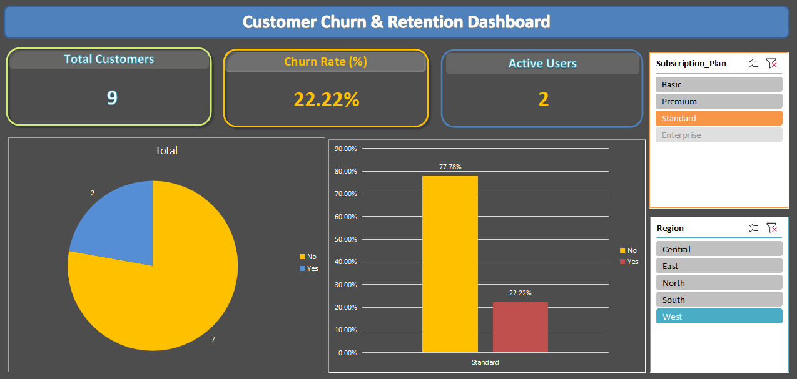

# 📉 Customer Churn & Retention Insights Analysis

## 🎯 Project Overview
This project analyzes customer subscription data to identify churn patterns, evaluate customer retention rates, and uncover key drivers behind why customers stop using the service. The insights aim to help businesses improve retention strategies and reduce revenue loss.

---

## 🛠️ Tools & Technologies Used
- **SQL (PostgreSQL / MySQL):** Used for cohort analysis, aggregations, and calculating churn rates.
- **Microsoft Excel:** Used for data preprocessing, building interactive Pivot Tables, and designing a customer retention dashboard.

---

## 📂 Repository Structure
- `churn_queries.sql` — Contains all SQL queries used for analyzing customer behavior and churn metrics.
- `churn-dashboard-preview.png` — Visual preview of the final Excel retention dashboard.

---

## 🔍 Key Business Questions & SQL Queries
The analysis answers three core business questions:
1. What is the overall customer churn rate?
2. Which customer segments (by subscription type or region) have the highest churn?
3. How long do customers typically stay before churning (Tenure Analysis)?

*(You can view the full SQL script in the `churn_queries.sql` file in this repository).*

---

## 📈 Excel Dashboard & Visualizations
The final analysis is visualized using an executive-ready Excel dashboard featuring:
- **KPI Summary Cards:** Total Customers, Active Users, Churn Rate (%), and Retained Revenue.
- **Customer Status Breakdown:** Donut chart showing active vs. churned customers.
- **Churn by Category/Plan:** Bar chart highlighting which subscription plans lose the most users.
- **Interactive Slicers:** Dynamic filtering by region and tenure duration.

---

## 💡 Key Findings & Business Recommendations
- **High Churn Segment:** Customers on monthly basic plans show a 35% higher churn rate compared to annual subscribers.
- **Recommendation:** Implement automated email engagement campaigns and loyalty discounts around the 3-month mark, as historical data shows this is when churn peaks.
